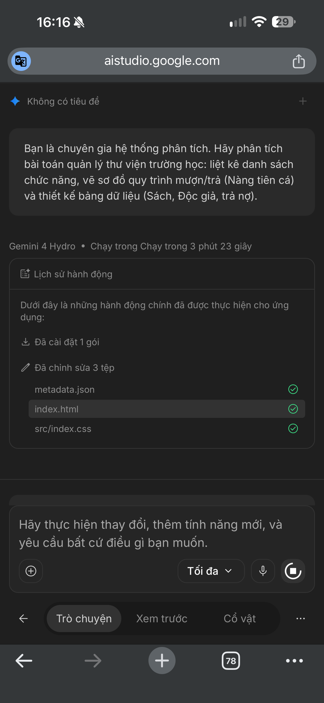
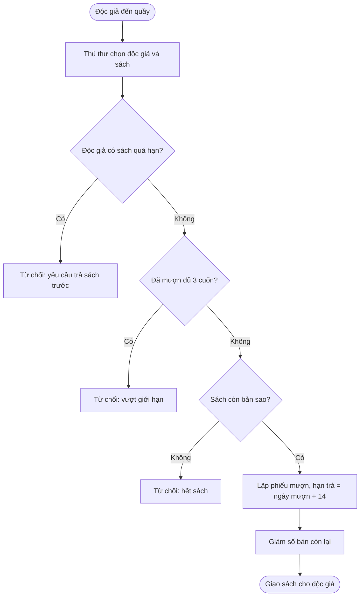
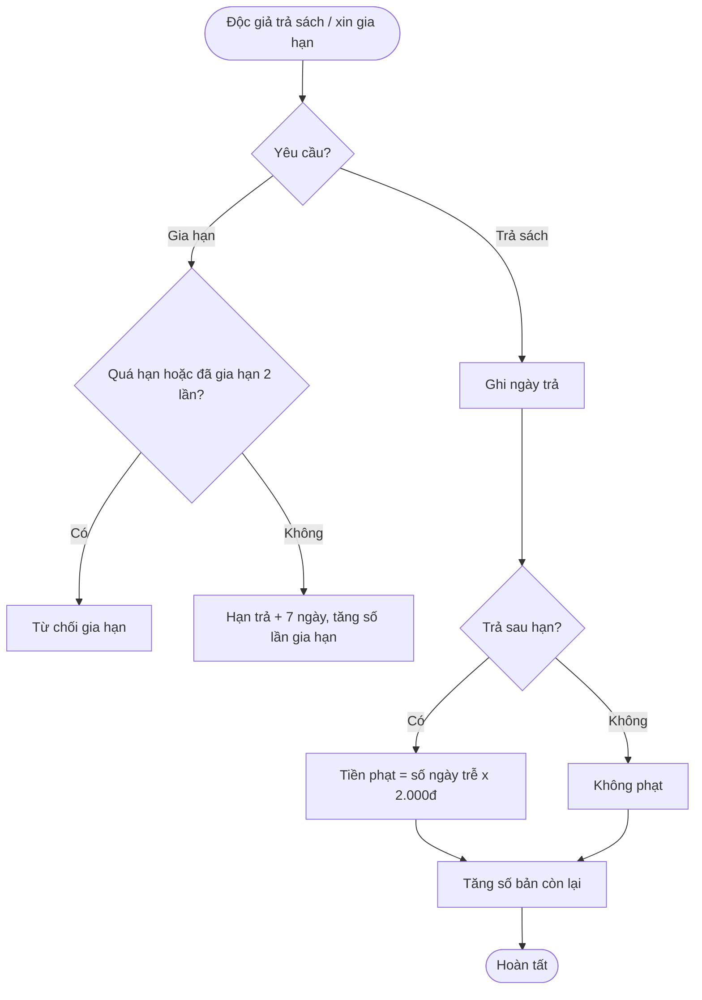
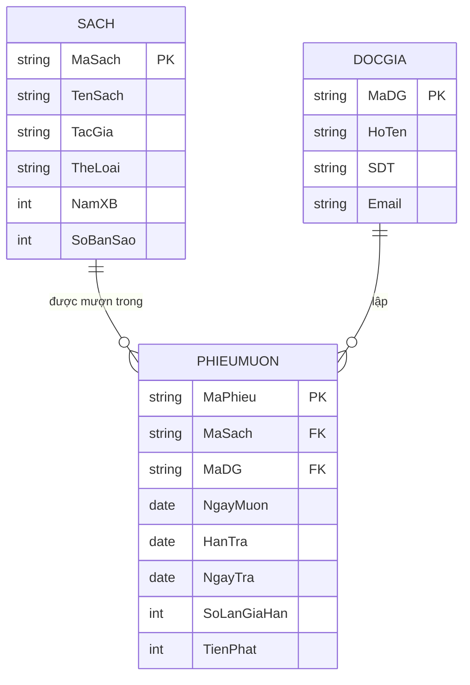
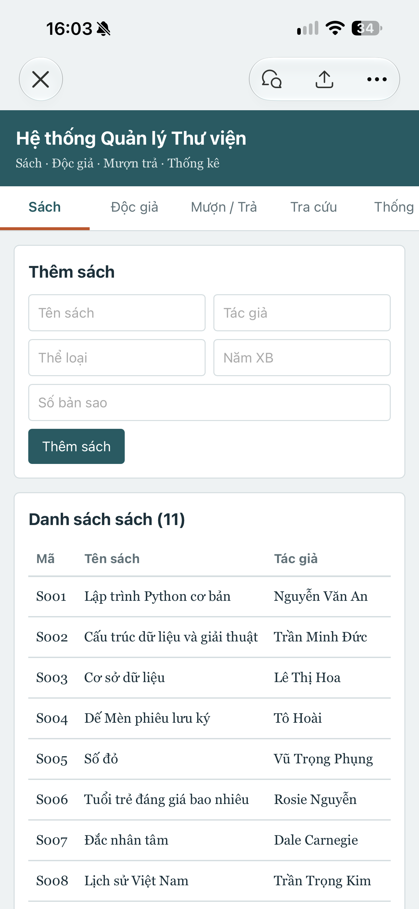
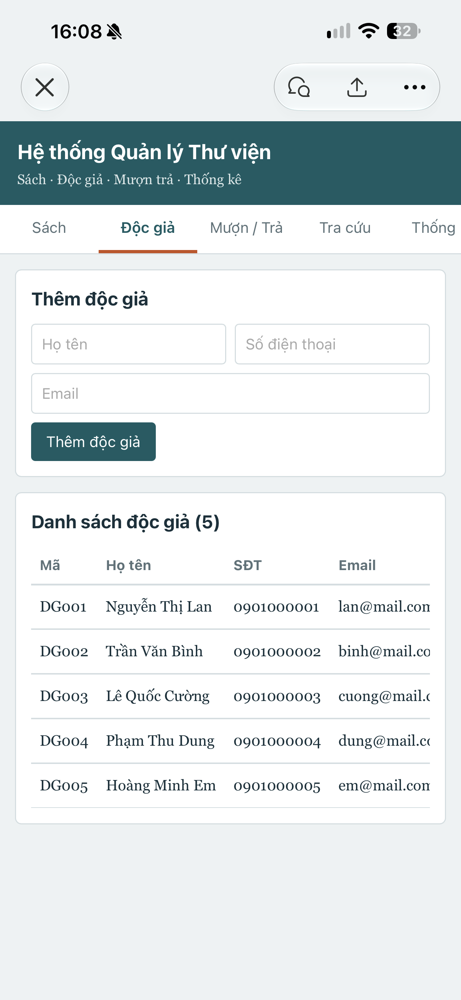
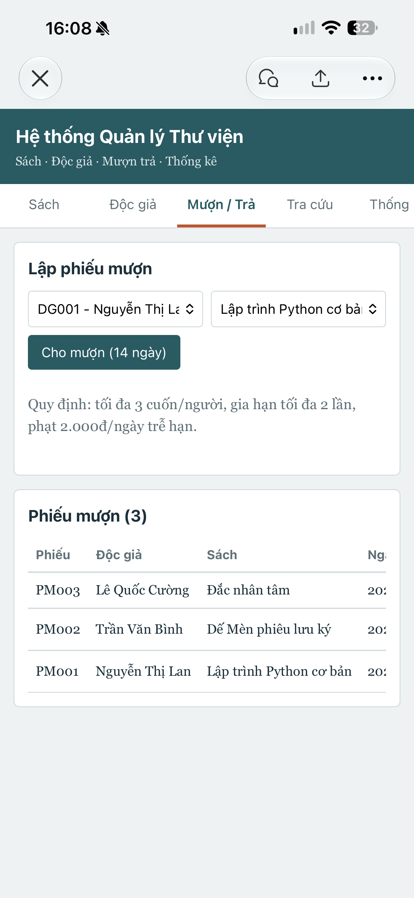
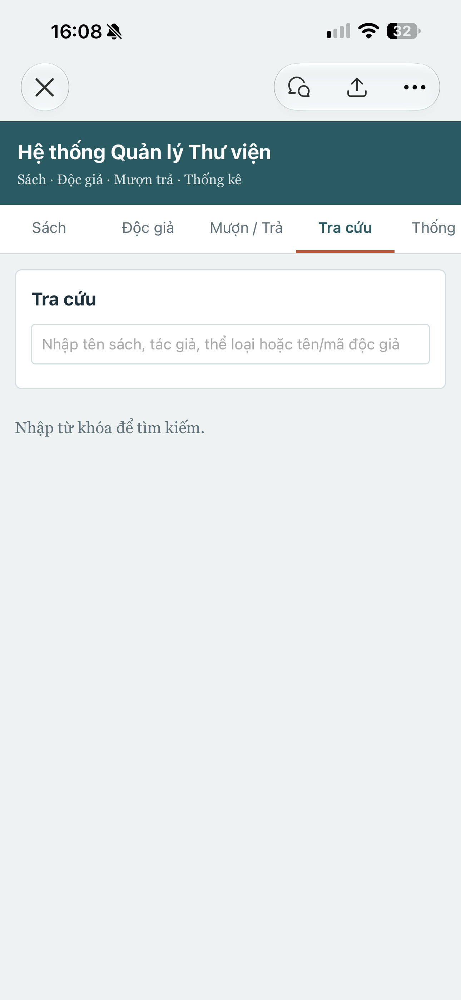
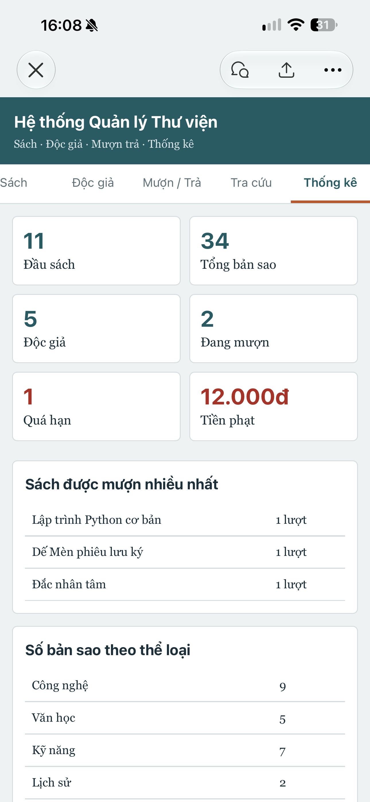

# BÁO CÁO LAB: PHÂN TÍCH, THIẾT KẾ VÀ XÂY DỰNG HỆ THỐNG QUẢN LÝ THƯ VIỆN ỨNG DỤNG CÔNG CỤ AI

- **Sinh viên:** Đặng Ngọc Tân – **MSSV:** 29214627267 – **Lớp:** [Lớp]
- **Công cụ AI:** Google AI Studio (phân tích, thiết kế, sinh mã nguồn)
- **Sản phẩm:** Web App chạy trên trình duyệt (`src/index.html`), lưu dữ liệu bằng LocalStorage

---

## 1. Chuẩn bị môi trường & công cụ AI

1. Truy cập https://aistudio.google.com/ và đăng nhập bằng tài khoản Google.
2. Tạo dự án mới tên `Lab_QLThuVien_29214627267_DangNgocTan`.
3. Dùng AI để phân tích nghiệp vụ, thiết kế dữ liệu và sinh mã nguồn.

**Minh chứng sử dụng Google AI Studio** (nhập yêu cầu phân tích bài toán quản lý thư viện, AI tạo và chỉnh sửa các tệp của ứng dụng):

---

## 2. Phân tích hệ thống

### 2.1. Bài toán
Thư viện quản lý thủ công bằng sổ sách nên dễ nhầm lẫn khi ghi chép mượn – trả, khó theo dõi tình trạng sách khi kho lớn, và tra cứu chậm. Hệ thống mới tin học hóa quy trình để tăng độ chính xác, tự động tra cứu – thống kê và tiết kiệm thời gian.

### 2.2. Tác nhân
| Tác nhân | Vai trò |
|---|---|
| Thủ thư | Quản lý sách, độc giả; lập phiếu mượn, nhận trả, gia hạn, thu phạt, xem thống kê |
| Độc giả | Tra cứu sách, mượn, trả, gia hạn sách |

### 2.3. Danh sách chức năng
| STT | Nhóm | Chức năng | Mô tả |
|---|---|---|---|
| 1 | Sách | Thêm sách | Nhập tên, tác giả, thể loại, năm XB, số bản sao; mã sinh tự động |
| 2 | Sách | Xóa sách | Chỉ xóa khi không có bản nào đang được mượn |
| 3 | Sách | Xem danh sách, số bản còn lại | Hiển thị "còn/tổng" cho từng đầu sách |
| 4 | Độc giả | Thêm, xóa độc giả | Không xóa khi độc giả chưa trả sách |
| 5 | Mượn trả | Lập phiếu mượn | Kiểm tra sách còn bản, giới hạn 3 cuốn, không nợ quá hạn |
| 6 | Mượn trả | Trả sách | Ghi ngày trả, tự tính tiền phạt, tăng lại số bản còn |
| 7 | Mượn trả | Gia hạn | +7 ngày, tối đa 2 lần, không gia hạn phiếu quá hạn |
| 8 | Tra cứu | Tìm sách | Theo tên, tác giả, thể loại |
| 9 | Tra cứu | Lịch sử mượn | Theo tên hoặc mã độc giả |
| 10 | Thống kê | Báo cáo | Tổng đầu sách, bản sao, độc giả, đang mượn, quá hạn, tiền phạt, top sách mượn nhiều, bản sao theo thể loại |

### 2.4. Quy tắc nghiệp vụ
- Thời hạn mượn 14 ngày; gia hạn +7 ngày, tối đa 2 lần.
- Mỗi độc giả mượn tối đa 3 cuốn cùng lúc.
- Độc giả có sách quá hạn không được mượn thêm.
- Phạt 2.000đ cho mỗi ngày trễ hạn.
- Số bản còn lại = Tổng bản sao − số phiếu đang mượn của sách đó.

---

## 3. Sơ đồ quy trình

### 3.1. Quy trình Mượn sách

### 3.2. Quy trình Trả sách và Gia hạn

---

## 4. Thiết kế dữ liệu

### 4.1. Sơ đồ quan hệ (ER)

### 4.2. Bảng mô tả cấu trúc dữ liệu

**SACH**
| Trường | Kiểu | Ràng buộc | Mô tả |
|---|---|---|---|
| MaSach | Chuỗi | Khóa chính (S001...) | Mã đầu sách |
| TenSach | Chuỗi | Bắt buộc | Tên sách |
| TacGia | Chuỗi | Bắt buộc | Tác giả |
| TheLoai | Chuỗi | Bắt buộc | Thể loại |
| NamXB | Số nguyên | | Năm xuất bản |
| SoBanSao | Số nguyên | > 0 | Tổng số bản sao |

**DOCGIA**
| Trường | Kiểu | Ràng buộc | Mô tả |
|---|---|---|---|
| MaDG | Chuỗi | Khóa chính (DG001...) | Mã độc giả |
| HoTen | Chuỗi | Bắt buộc | Họ tên |
| SDT | Chuỗi | Bắt buộc | Số điện thoại |
| Email | Chuỗi | | Email |

**PHIEUMUON**
| Trường | Kiểu | Ràng buộc | Mô tả |
|---|---|---|---|
| MaPhieu | Chuỗi | Khóa chính (PM001...) | Mã phiếu |
| MaSach | Chuỗi | Khóa ngoại → SACH | Sách được mượn |
| MaDG | Chuỗi | Khóa ngoại → DOCGIA | Độc giả mượn |
| NgayMuon | Ngày | Bắt buộc | Ngày lập phiếu |
| HanTra | Ngày | Bắt buộc | NgayMuon + 14 (+7 mỗi lần gia hạn) |
| NgayTra | Ngày | Null nếu chưa trả | Ngày trả thực tế |
| SoLanGiaHan | Số nguyên | 0 đến 2 | Số lần đã gia hạn |
| TienPhat | Số nguyên | ≥ 0 | Tiền phạt khi trả trễ |

*Trong mã nguồn, dữ liệu lưu trong LocalStorage dưới dạng JSON với 3 tập `books`, `members`, `loans` tương ứng 3 bảng trên (tên trường viết tiếng Anh).*

---

## 5. Triển khai và kiểm thử

### 5.1. Quá trình triển khai với AI
1. Dùng AI để lập danh sách chức năng, sơ đồ quy trình và mô hình dữ liệu (mục 2 đến 4).
2. Đưa đặc tả đó cho AI sinh ứng dụng web một file (HTML, CSS, JavaScript).
3. Nạp dữ liệu mẫu, chạy thử, kiểm tra lỗi và chỉnh sửa theo các quy tắc nghiệp vụ.

Prompt chính đã dùng (rút gọn):
> "Dựa trên danh sách chức năng, quy trình mượn/trả và cấu trúc dữ liệu sau, hãy viết ứng dụng web quản lý thư viện bằng HTML/CSS/JS thuần, lưu dữ liệu bằng LocalStorage, có dữ liệu mẫu, giao diện tiếng Việt, chạy được trên điện thoại."

### 5.2. Ca kiểm thử
| STT | Tình huống | Kết quả mong đợi | Kết quả |
|---|---|---|---|
| 1 | Thêm sách đủ thông tin | Sách xuất hiện trong danh sách | Đạt |
| 2 | Thêm sách thiếu tên | Báo lỗi, không thêm | Đạt |
| 3 | Mượn sách còn bản sao | Tạo phiếu, hạn trả +14 ngày, số bản còn giảm 1 | Đạt |
| 4 | Mượn sách đã hết bản | Mục sách bị khóa / báo hết sách | Đạt |
| 5 | Độc giả mượn quá 3 cuốn | Báo vượt giới hạn | Đạt |
| 6 | Độc giả có sách quá hạn mượn thêm | Từ chối | Đạt |
| 7 | Gia hạn phiếu trong hạn | Hạn trả +7 ngày | Đạt |
| 8 | Gia hạn lần thứ 3 | Từ chối | Đạt |
| 9 | Trả sách trễ hạn | Tính phạt 2.000đ x số ngày trễ | Đạt |
| 10 | Xóa sách đang có người mượn | Từ chối xóa | Đạt |
| 11 | Tra cứu theo tác giả / tên độc giả | Hiện sách / lịch sử mượn phù hợp | Đạt |
| 12 | Tải lại trang | Dữ liệu vẫn còn nhờ LocalStorage | Đạt |

**Ảnh chụp màn hình ứng dụng khi chạy thử (tab Sách, nhập thêm 1 sách mới, danh sách hiển thị 11 đầu sách):**

**Tab Độc giả (5 độc giả mẫu):**

**Tab Mượn / Trả (form lập phiếu mượn và danh sách 3 phiếu mượn):**

**Tab Tra cứu (tìm theo tên sách, tác giả, thể loại, tên/mã độc giả):**

**Tab Thống kê (11 đầu sách, 34 bản sao, 5 độc giả, 2 phiếu đang mượn, 1 quá hạn, tiền phạt 12.000đ):**

### 5.3. Hạn chế và hướng phát triển
- Dữ liệu lưu cục bộ trên từng trình duyệt; có thể nâng cấp lên SQLite hoặc Supabase để dùng chung nhiều máy.
- Mỗi phiếu mượn một cuốn; có thể mở rộng thành phiếu nhiều cuốn.
- Bổ sung đăng nhập phân quyền thủ thư / độc giả, quét mã vạch, nhắc hạn qua email.

---

## 6. Kết luận
Hệ thống đáp ứng các yêu cầu của bài Lab: có phân tích chức năng, quy trình, mô hình dữ liệu, và một ứng dụng chạy được từ các đặc tả đó. Công cụ AI giúp rút ngắn đáng kể thời gian phân tích và lập trình, nhưng vẫn cần người làm kiểm tra lại nghiệp vụ và kết quả sinh ra.
